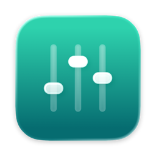
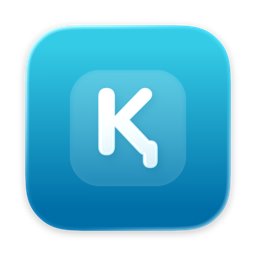
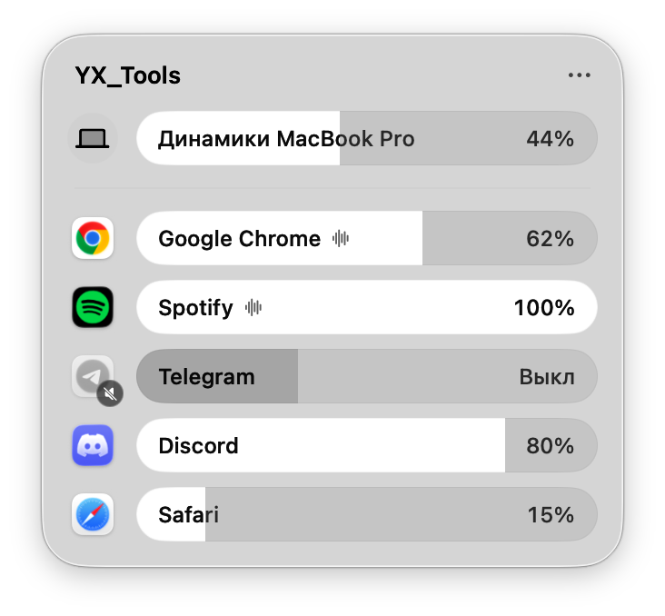

<div align="center">



# YX_Tools

**Утилиты для строки меню macOS**<br>
громкость каждого приложения и казахская клавиатура: по отдельности или в одном значке

[](https://github.com/Bexull/YX_Tools/releases/latest)


[](LICENSE)

</div>

## Инструменты

<table>
<tr>
<td width="50%" align="center" valign="top">
<a href="https://github.com/Bexull/YX_Dybys"></a>
<h3><a href="https://github.com/Bexull/YX_Dybys">YX_Dybys</a></h3>
Громкость каждого приложения из строки меню.<br>
Стеклянная панель, как Пункт управления.<br><br>
<a href="https://github.com/Bexull/YX_Dybys/releases/latest"><b>Скачать</b></a> ·
<a href="https://github.com/Bexull/YX_Dybys#readme">Подробнее</a>
</td>
<td width="50%" align="center" valign="top">
<a href="https://github.com/Bexull/YX_KazQwerty"></a>
<h3><a href="https://github.com/Bexull/YX_KazQwerty">YX_KazQwerty</a></h3>
Раскладка «Русская + Қазақша» и автозамена:<br>
«салеметсизбе» → «Сәлеметсіз бе».<br>
Есть <a href="https://github.com/Bexull/YX_KazQwerty/tree/main/Windows">бета для Windows</a>.<br><br>
<a href="https://github.com/Bexull/YX_KazQwerty/releases/latest"><b>Скачать</b></a> ·
<a href="https://github.com/Bexull/YX_KazQwerty#readme">Подробнее</a>
</td>
</tr>
</table>

## YX_Tools: оба в одном значке

<div align="center">
<picture>
  <source media="(prefers-color-scheme: dark)" srcset="docs/images/panel-dark.png">
  
</picture>
</div>

Если нужны оба инструмента, можно поставить одно приложение вместо двух. Панель та же, что
у YX_Dybys, а настройки казахской клавиатуры лежат в «⋯» и в меню по правому клику на значок.

## Какой выбрать

| Нужно | Ставьте |
|---|---|
| Громкость приложений | [YX_Dybys](https://github.com/Bexull/YX_Dybys/releases/latest) |
| Казахская клавиатура | [YX_KazQwerty](https://github.com/Bexull/YX_KazQwerty/releases/latest) |
| И то и другое, одним значком | [YX_Tools](https://github.com/Bexull/YX_Tools/releases/latest) |

> [!IMPORTANT]
> В YX_Tools уже есть оба инструмента. Не запускайте его вместе с YX_Dybys или YX_KazQwerty:
> громкость менялась бы дважды, а каждое слово исправлялось бы два раза. YX_Dybys и
> YX_KazQwerty друг другу не мешают.

## Установка YX_Tools

Нужны **macOS 26 Tahoe** и Mac на **Apple silicon** (M1 и новее).

1. Скачайте `YX_Tools-1.0.zip` со страницы [последнего выпуска](https://github.com/Bexull/YX_Tools/releases/latest)
   и откройте архив.
2. Перетащите YX_Tools в папку «Программы».
3. Разрешите первый запуск. Приложение не нотаризовано Apple, поэтому macOS его остановит.
   Откройте YX_Tools, нажмите «Готово», затем «Системные настройки» → «Конфиденциальность
   и безопасность» → внизу «Всё равно открыть». Или одной командой в Терминале:

   ```bash
   xattr -dr com.apple.quarantine /Applications/YX_Tools.app
   ```

4. Клик по значку с ползунками открывает панель. Когда вы первый раз убавите громкость
   приложения, macOS попросит разрешение на запись системного звука; сам звук никуда
   не записывается.
5. Казахская клавиатура: «⋯» в панели → «Казахская клавиатура» → «Установить раскладку
   «Русская + Қазақша»». Потом панель попросит «Универсальный доступ» для правого ⌘ и
   автозамены. Перезапустите открытые программы из App Store (Teams, Telegram, WhatsApp)
   или просто выйдите из системы и войдите снова.

Чтобы YX_Tools запускался сам: правый клик по значку → «Открывать при входе в систему».

Как пользоваться каждой частью: [громкость](https://github.com/Bexull/YX_Dybys#readme),
[клавиатура и автозамена](https://github.com/Bexull/YX_KazQwerty#readme).
Там же частые вопросы.

## Сборка из исходников

YX_Dybys и YX_KazQwerty подключены сюда как git-подмодули; YX_Tools собирает их код в одно
приложение. Нужны macOS 26 и Xcode 26.

```bash
git clone --recursive https://github.com/Bexull/YX_Tools.git
cd YX_Tools
./build.sh --install
```

- Склонировали без `--recursive`? Выполните `git submodule update --init`.
- Подтянуть последние версии инструментов: `git submodule update --remote`.
- `./build.sh` только собирает `build/YX_Tools.app`, `--install` ставит в «Программы»,
  `--release` ещё и пакует `build/YX_Tools-<версия>.zip`. Подпись своим сертификатом
  настраивается так же, как в [YX_Dybys](https://github.com/Bexull/YX_Dybys#readme).

## Как устроено

- `YX_Dybys/`, `YX_KazQwerty/`: подмодули с исходниками обоих инструментов.
- `Sources/ToolsApp.swift`: значок в строке меню и меню по правому клику.
- `Sources/PanelKeyboard.swift`: настройки клавиатуры в панели микшера, через `PanelAdditions`
  из YX_Dybys.
- `Resources/`: Info.plist и иконка Liquid Glass. Идентификатор `com.bexul.mixer` остался от
  первой версии, которая называлась «Микшер»: так её настройки перешли к YX_Tools.

Нашли ошибку? Создайте issue в репозитории
[YX_Dybys](https://github.com/Bexull/YX_Dybys/issues/new/choose) (звук) или
[YX_KazQwerty](https://github.com/Bexull/YX_KazQwerty/issues/new/choose) (клавиатура).

## Лицензия

Код распространяется по лицензии [MIT](LICENSE). Данные автозамены YX_KazQwerty — по
[CC BY-SA 4.0](https://github.com/Bexull/YX_KazQwerty/blob/main/Resources/kazakh/LICENSE.md).

---

### In English

**YX_Tools** is a small set of macOS 26 menu bar utilities for Apple silicon:

- [YX_Dybys](https://github.com/Bexull/YX_Dybys): per-app volume in a Liquid Glass panel.
- [YX_KazQwerty](https://github.com/Bexull/YX_KazQwerty): a Russian + Kazakh keyboard layout with
  an on-device autocorrect that turns Kazakh typed with Russian letters into proper spelling.
  It also has a [Windows beta](https://github.com/Bexull/YX_KazQwerty/tree/main/Windows).

Use them separately, or install YX_Tools, which puts both behind one menu bar icon (don't run it
alongside the separate apps). Download from [Releases](https://github.com/Bexull/YX_Tools/releases/latest),
then run `xattr -dr com.apple.quarantine /Applications/YX_Tools.app`, since the app is not
notarized. Build with `git clone --recursive` and `./build.sh`. Code: MIT.
